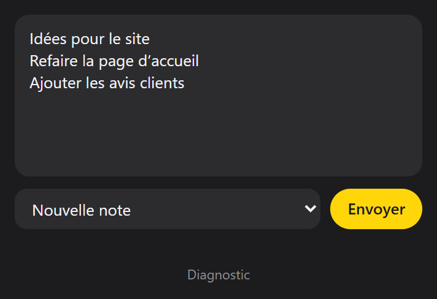
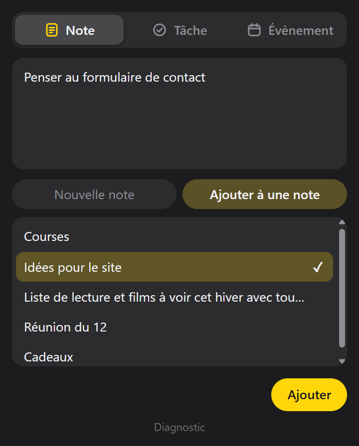
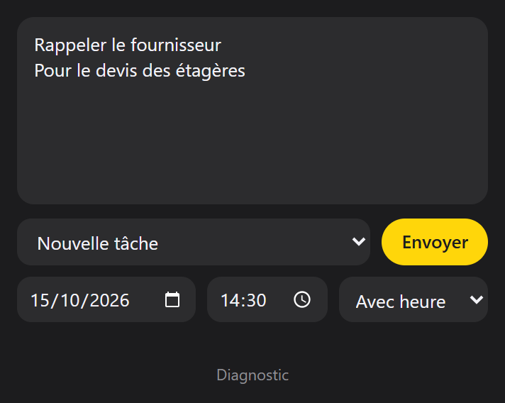
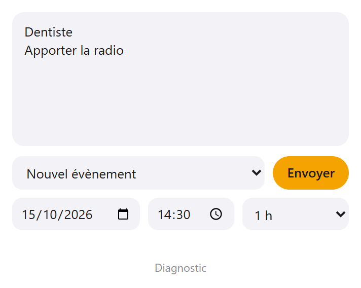

# Hop

A Chrome extension that sends text to Apple Notes, Reminders and Calendar from a Windows PC (or any computer with Chrome), so it shows up on your iPhone a moment later.

## What it does

- **New note.** Write in the popup, or select text on a page first and it is picked up with the page address. The first line becomes the title.
- **Add to a note.** Choose one of your 12 most recent notes from the list and the text is added at its end. The rest of the note, with its formatting, checklists and attachments, is left as it is.
- **New task.** The first line is the title, the rest goes in the task's notes. A due date is optional, with or without a time.
- **New event.** Pick a date, a start time and a length (30 min, 1 h, 2 h or the whole day).
- **Right click.** "Nouvelle note Apple avec la sélection" and "Nouvelle tâche Apple avec la sélection" on any selected text.
- **One place to sort.** Tasks go to a Reminders list named `Hop` and events to a calendar named `Hop`, so you can tell what came from the extension and keep or delete it later.

 

The popup opens with the toolbar button or `Alt+Shift+N`, on the tab you used last. The interface is in French.

## Before you start

1. Sign in to [icloud.com](https://www.icloud.com) in Chrome. Hop works through the pages you are signed in to and never sees your Apple password.
2. Create a Reminders list named `Hop` and a calendar named `Hop` (on your iPhone or on icloud.com). Hop does not create them. Notes go to your default Notes folder.

If Advanced Data Protection is on for your Apple account, web access to iCloud has to be allowed from your iPhone first.

## Install

The extension is not on the Chrome Web Store, so it is loaded by hand:

1. Download this repository (**Code**, then **Download ZIP**) and unzip it, or clone it.
2. Open `chrome://extensions` and turn on **Developer mode**.
3. Click **Load unpacked** and choose the folder.

## How it works, and what that means

Apple offers no public way to write to Notes, Reminders or Calendar from outside its own apps. Hop works around this: it keeps one icloud.com tab per app (Notes, Reminders, Calendar) and asks the web app in that tab to do the work, the same way the app does it when you type and click yourself. The data is therefore written by Apple's own code, in Apple's own format.

This has consequences worth knowing:

- **It is unofficial.** Hop relies on how the icloud.com apps are built inside. When Apple changes them, a feature can stop working until the extension is updated. The **Diagnostic** link in the popup records the structure of the three apps (names of functions and properties, never your content) in a file that helps find what changed.
- **It needs the tabs.** The first action for each app opens its icloud.com tab and takes a few seconds. After that the tab is reused. Hop keeps these tabs in a separate window that stays minimized; if you already have the app open in a tab of your own, it uses that one. If your iCloud session has expired, Hop shows the tab so you can sign in.
- **Plain text only.** What Hop sends is text. It does not add formatting, images or attachments.
- **Time zone.** Event and task times are read in your iCloud account's time zone, which is normally the one your computer uses.

Hop is a personal project. It is not affiliated with or endorsed by Apple.

## Privacy

Everything happens in your browser, between Hop and the icloud.com tabs. The extension has no server and sends nothing anywhere else.

| Permission | Why it is needed |
| --- | --- |
| Access to `www.icloud.com` | Ask the Notes, Reminders and Calendar web apps to create what you send |
| `scripting` and `activeTab` | Read the text you selected on the current page, and show the result on it |
| `contextMenus` | Add the two right-click entries |
| `downloads` | Save the diagnostic file when you ask for it |

## License

[MIT](LICENSE) © 2026 Yanis Arris
